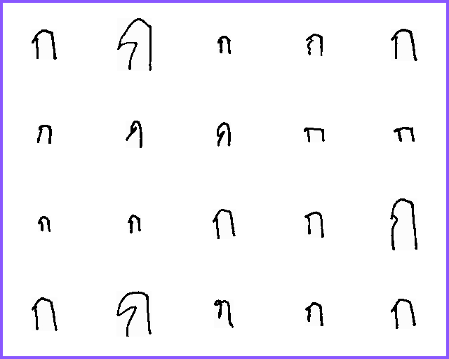
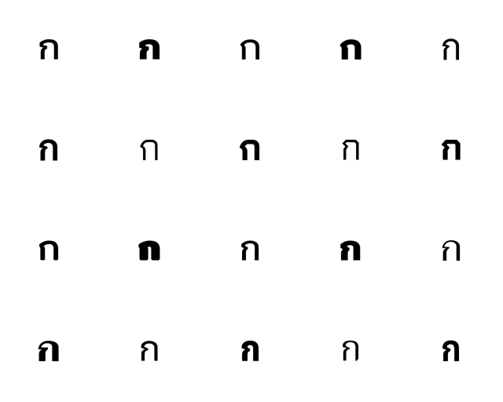

# Thai Character Classification

ใช้ **MobileNetV3-Large** จำแนกพยัญชนะ สระ วรรณยุกต์ เครื่องหมาย และตัวเลขไทย
รวม **80 คลาส** ด้วย PyTorch

## Character Samples

ตัวอักษร **ก** แบบลายมือจาก ALICE-THI และแบบตัวพิมพ์จากชุด PrintFont
แสดงความแตกต่างของรูปทรง สัดส่วน และน้ำหนักเส้นภายในคลาสเดียวกัน

| ลายมือ · ALICE-THI | ตัวพิมพ์ · PrintFont |
| :---: | :---: |
|  |  |

## Quick Start

เลือก notebook ตามงานที่ต้องการ แล้วเปิดใน Google Colab:

| งาน | ไฟล์ที่ใช้ | ผลลัพธ์หลัก |
| :--- | :--- | :--- |
| **ฝึกโมเดล** | [Training notebook](notebooks/person3_mobilenetv3_colab.ipynb) | checkpoint, ประวัติการฝึก และกราฟ |
| **ประเมินผล** | [Evaluation notebook](notebooks/person3_mobilenetv3_evaluation_colab.ipynb) | คำทำนาย ตัวชี้วัด และ confusion matrix เมื่อมีเฉลย |
| **สร้างไฟล์ส่งคำตอบ** | [Submission notebook](notebooks/person3_mobilenetv3_submission_colab.ipynb) | `submission.csv` ตามแม่แบบ Project 1 |

1. เตรียมชุดข้อมูลหรือ checkpoint บน Google Drive ตามงานที่เลือก
2. เปิด notebook เชื่อมต่อ Drive แล้วแก้ path ใน cell ตั้งค่า สำหรับฝึกโมเดลต้องใช้ GPU
3. รัน cell ตามลำดับ ผลลัพธ์จะบันทึกใน `OUTPUT_DIR` ที่กำหนด

**ชุดข้อมูล checkpoint และฟอนต์ไม่ได้รวมอยู่ใน repository** ต้องใช้ไฟล์เดิมหรือขอจากเจ้าของข้อมูล
ดู [ตำแหน่งไฟล์และวิธีตั้งค่า](docs/usage.md) ก่อนรัน

## Training Approach

ภาพต้นฉบับมีสัดส่วนต่างกัน จึงเติมขอบสีขาวแบบ **letterbox** ให้ได้ภาพ RGB ขนาด
**160 × 160 พิกเซล** แล้วปรับค่าพิกเซลด้วย ImageNet normalization
ใช้ขั้นตอนเดียวกันทั้งตอนฝึกและตอนทำนาย

การฝึกเริ่มจากน้ำหนัก ImageNet แล้วเปลี่ยนหัวจำแนกเป็น 80 คลาส:

1. **ฝึกหัวจำแนก** — ตรึง feature extractor แล้วฝึก classifier สูงสุด 3 epochs
2. **ปรับทั้งโมเดล** — ปลด backbone แล้ว fine-tune สูงสุด 12 epochs โดยใช้ learning rate ต่ำกว่า classifier 10 เท่า
3. **เลือก checkpoint** — บันทึกรอบที่ validation accuracy สูงสุด และใช้ validation loss สำหรับ early stopping

ใช้ภาพที่ทำ augmentation ไว้แล้วเฉพาะฝั่งฝึก ร่วมกับ class-weighted loss,
label smoothing `0.1` และ mixed precision บน GPU โดยกำหนด seed เป็น `42`

> **การแบ่งข้อมูล:** notebook ใช้ split 80/20 ที่เตรียมไว้แล้ว โฟลเดอร์ชื่อ
> `split_80_20/test` ทำหน้าที่เป็น **validation** ของงานนี้ ส่วนชุดทดสอบจริงของอาจารย์ใช้แยกต่างหาก

## Results

ค่าที่บันทึกไว้ใน [model card](docs/evaluation/model_card.json):

| ชุดประเมิน | Accuracy | ขอบเขตของผล |
| :--- | ---: | :--- |
| Validation | **99.54%** | ค่าสูงสุดที่บันทึกไว้ระหว่างการฝึก |
| Mock จาก validation | **99.50%** | เป็นส่วนหนึ่งของ validation ไม่ใช่ชุดทดสอบอิสระ |

ตัวเลขข้างต้นเป็นผลเดิมของโครงการ ยังไม่ได้รันประเมินใหม่จากการจัด repository
ดูค่าราย epoch ได้ใน [ประวัติการฝึก](docs/evaluation/training_history.csv)

Notebook ประเมินรองรับชุดภาพแบบ ZIP หรือโฟลเดอร์ สร้าง `predictions.csv` และสรุปการรัน
ได้โดยไม่ต้องฝึกใหม่ เมื่อมีเฉลยจะคำนวณ Accuracy, Balanced Accuracy, Macro F1,
Weighted F1 พร้อมรายงานรายคลาสและคู่ตัวอักษรที่สับสน

สำหรับชุดภายนอก **ALICE-THI ครอบคลุม 77 จาก 80 คลาส** ส่วน PrintFont เป็นภาพตัวพิมพ์ที่สร้างจากฟอนต์
ควรรายงานผลแต่ละชุดแยกกัน ไม่รวมเป็นคะแนนเดียว

## Project Submission

โมเดลจำแนก 80 คลาส แต่แม่แบบงานนี้ใช้ **72 คลาส** Notebook ส่งงานจึงกรองคำตอบตาม
`Project_1-data_dict.csv` ก่อนเลือกคลาส แล้วเทียบชื่อภาพกับ `gt_path` ในแม่แบบ
และกรอกเฉพาะคอลัมน์กลุ่มที่ตั้งไว้ใน `TEAM_COLUMN`

ค่าที่ส่งเป็น **`class_id` ของ Project 1** ไม่ใช่รหัส TIS-620 หรือ model index
พร้อมตรวจจำนวนแถวและการจับคู่ชื่อภาพก่อนสร้าง `submission.csv`
ดู [ขั้นตอนตั้งค่า](docs/usage.md#ตั้งค่าก่อนสร้างไฟล์ส่งคำตอบ)

## Project Structure

```text
notebooks/          Notebook สำหรับฝึก ประเมิน และส่งคำตอบ
scripts/            สร้างชุดทดสอบตัวพิมพ์ ชุดจำลอง และภาพตัวอย่าง
data/metadata/      รายการคลาส ตารางเทียบรหัส และแม่แบบส่งคำตอบ
docs/               คู่มือ รายละเอียดโมเดล และสไลด์นำเสนอ
models/README.md    วิธีเตรียม checkpoint
requirements.txt    ไลบรารีสำหรับรันในเครื่อง
```

สคริปต์ใน `scripts/` ใช้สร้างชุดตัวพิมพ์ขนาดเล็ก ชุดตัวพิมพ์ขนาดใหญ่ 32,000 ภาพ
และชุดจำลอง Project 1 จำนวน 500 ภาพ โดยแยกเฉลยออกจาก ZIP สำหรับทำนาย
อ่าน [วิธีติดตั้งและรันสคริปต์](docs/usage.md#ติดตั้งและรันสคริปต์ในเครื่อง)

ชุดข้อมูล โมเดล ฟอนต์ ZIP ผลส่งคำตอบ และ notebook เก่าจะเก็บในเครื่องตาม `.gitignore`
จึงไม่ถูกรวมเมื่อ clone โครงการ

## Documentation

| Document | Description |
| :--- | :--- |
| [Usage Guide](docs/usage.md) | วิธีติดตั้ง ตั้งค่า path รันสคริปต์ และสร้างไฟล์ส่งคำตอบ |
| [Data Guide](data/README.md) | รายละเอียดชุดข้อมูลและตำแหน่งจัดเก็บ |
| [Model Guide](models/README.md) | วิธีเตรียม checkpoint สำหรับใช้งาน |
| [Model Card](docs/evaluation/model_card.json) | สถาปัตยกรรม การเตรียมภาพ และผลประเมินที่บันทึกไว้ |
| [Training History](docs/evaluation/training_history.csv) | ค่าการฝึกราย epoch |
| [Presentation](docs/slide_dl_presentation.pdf) | สไลด์นำเสนอโครงการ |

## License

[MIT License](LICENSE) สำหรับโค้ดและเอกสารที่ทีมสร้าง
ส่วนข้อมูล ฟอนต์ โมเดล และเนื้อหาจากภายนอกอยู่ภายใต้ [เงื่อนไขแยก](THIRD_PARTY_NOTICES.md)
